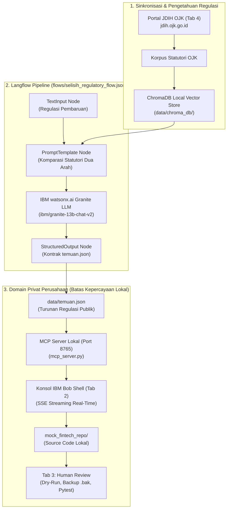

# SELISIH — Regulatory Change & Code Impact System

Platform Enterprise Kepatuhan Regulasi untuk Hackathon **IBM x Hacktiv8 (IT-Finance)**.
Menjembatani **dokumen regulasi OJK** dengan **repositori kode perbankan dan fintech**, lalu memetakan
dampak perubahannya secara *human-in-the-loop* menggunakan orkestrasi **Langflow**, kecerdasan **IBM watsonx Granite**, dan agen coding lokal **IBM Bob**.

---

## Diagram Alur Arsitektur End-to-End



---

## Arsitektur Platform

Platform SELISIH beroperasi dengan arsitektur web modern mandiri:
1. **Frontend**: Next.js 15 (React 19, TypeScript, Tailwind CSS, Lucide Icons) di port `3000`.
2. **Backend**: FastAPI REST & Server-Sent Events (SSE) Streaming di port `8000` (`api.py`).
3. **Pipeline Orchestrator**: Langflow REST API (`http://localhost:7860`) & Embedded Flow Engine (`flows/selisih_regulatory_flow.json`).
4. **LLM Engine**: IBM watsonx Granite (`ibm/granite-13b-chat-v2`) untuk diferensiasi regulasi & verifikasi sitasi anti-halusinasi.
5. **Local MCP Server**: Python stdlib JSON-RPC dual-pintu di port `8765` untuk integrasi IDE IBM Bob.
6. **Vector Store**: ChromaDB lokal offline di `data/chroma_db/` tanpa ketergantungan cloud.

---

## Cara Menjalankan

### Opsi 1: Peluncur 1-Klik Terpadu (Paling Cepat)

Klik ganda berkas **`run_all.bat`**.
Skrip ini akan secara otomatis:
1. Menjalankan Backend FastAPI Server di port 8000 pada jendela terpisah.
2. Membangun dan menjalankan Frontend Next.js di port 3000.
3. Membuka peramban web ke `http://localhost:3000`.

### Opsi 2: Manual Lewat Terminal

1. **Instalasi Dependensi**:
   ```bash
   pip install -r requirements.txt
   cd frontend && npm install && cd ..
   ```

2. **Jalankan Backend FastAPI (Terminal 1)**:
   ```bash
   run_api.bat
   # atau: python -m uvicorn api:app --host 127.0.0.1 --port 8000 --reload
   ```

3. **Jalankan Frontend Next.js (Terminal 2)**:
   ```bash
   run_web.bat
   # atau: cd frontend && npm run start
   ```
   Buka peramban di `http://localhost:3000`.

---

## Modul Utama pada Platform Web

1. **Tab 1 — Analisis Perubahan Regulasi (Diff)**
   - Pemilih regulasi acuan dan pembaruan dinamis dari katalog JDIH OJK.
   - Komparasi dua arah berbasis orkestrasi Langflow & model IBM watsonx Granite.
   - 4 Metrik Validasi Kepatuhan: Klausul Terdampak, Validitas Sitasi (Anti-Halusinasi), Tingkat Keyakinan, dan Status Abstention.
   - Kartu perbandingan berdampingan (*side-by-side*) antara klausul acuan dan usulan pembaruan beserta kandidat kode terdampak.

2. **Tab 2 — Konsol Agen IBM Bob Shell & Integrasi MCP**
   - Terminal interaktif IBM Bob Shell dengan streaming penalaran agen AI secara real-time via Server-Sent Events (SSE).
   - Pengaman sesi (*session guard*): Tombol eksekusi terlindungi dan hanya aktif setelah analisis Tab 1 dijalankan pada sesi aktif.
   - Penampil berkas artefak handoff (`proposed_patch.diff`, `generated_tests.py`, `impact_report.json`) dengan *syntax highlighting* dan fitur unduh berkas.
   - Tombol peluncuran IBM Bob Desktop langsung ke repositori target lokal.

3. **Tab 3 — Tata Kelola & Tinjauan Dampak Kode (Human-in-the-Loop)**
   - Alur kerja bertahap bebas risiko (*Progressive Workflow*): Simulasi Dry-Run -> Tinjauan Diff Baris Kode -> Konfirmasi Patch -> Pengujian Otomatis Pytest Asli.
   - Deteksi nomor baris nyata secara dinamis (`selisih/impact.py`).
   - Pencadangan berkas otomatis (`.bak.<timestamp>`) sebelum penulisan kode.
   - Fitur Pemulihan Cadangan 1-Klik (*Rollback*) yang mencatat setiap tindakan ke Jejak Audit Enterprise.
   - Penegakan lisensi paket (*License Gating*): otomatis menonaktifkan penerapan patch bila kuota repositori penuh.

4. **Tab 4 — Katalog & Pemantau Regulasi OJK (JDIH)**
   - Sinkronisasi langsung ke portal resmi JDIH OJK (`jdih.ojk.go.id`).
   - Pemantauan POJK sektor Fintech (LPBBTI), Inovasi Teknologi (ITSK), dan Pelindungan Konsumen.
   - Tombol aksi cepat *"Analisis Dampak"* yang mengintegrasikan dokumen terpilih langsung ke Tab 1.

---

## Sistem Lisensi B2B & Manajemen Repositori

Sidebar menyediakan pengalih profil entitas perusahaan secara langsung:
- **PT Bank Digital Nusantara (Enterprise Plan)**: Kuota repositori tanpa batas, status lisensi aktif.
- **PT Dana Mandiri Fintech (Professional Plan)**: Kuota 25 repositori (terpakai 18), status lisensi aktif.
- **PT Pinjaman Kilat Indonesia (Starter Plan)**: Kuota 5 repositori (terpakai 5/5, kuota penuh), memicu *license gate* di mana tombol patch Tab 3 dikunci secara aman.

Modal **Manajer Repositori Terpadu** memungkinkan pendaftaran repositori lokal baru dengan verifikasi kuota paket secara instan.

---

## IBM Bob & Jembatan MCP Lokal

IBM Bob adalah *MCP client* di IDE lokal (bukan layanan REST eksternal). Jembatan komunikasi:
**Dashboard -> Server MCP Lokal (`mcp_server.py`) -> IBM Bob**, seluruhnya berjalan privat di `localhost`.

```bash
python mcp_server.py
```
- Registrasi server: `.bob/mcp.json`.
- Tools MCP: `get_temuan`, `list_artifacts`, `read_artifact`, `preview_patch`, `apply_patch`, `run_repo_tests`.
- Keamanan: Akses dibatasi ketat (*allowlist*) ke `mock_fintech_repo/` dan `artifacts/`.

---

## Menjalankan Pengujian Unit Test

```bash
# Seluruh unit test (FastAPI, Langflow, Vector Store, License, OJK, Impact, MCP, Mock Repo)
python -m pytest

# Hanya pengujian kepatuhan repo mock
python -m pytest mock_fintech_repo/tests
```

---

## Arsitektur Batas Kepercayaan (Trust Boundaries)

- **Domain Publik (Cloud):** Teks regulasi publik POJK, referensi hukum JDIH, Langflow/watsonx diff. **Kode perusahaan tidak pernah dikirim ke cloud.**
- **Domain Privat (Lokal):** Repositori kode sumber, IBM Bob, patch aman, dan unit test berjalan 100% lokal di mesin perusahaan.
- Satu-satunya artefak yang menyeberang adalah kontrak temuan regulasi publik (`data/temuan.json`).
