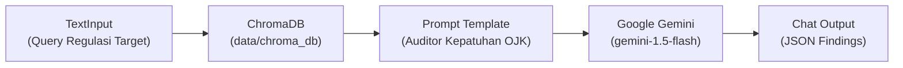

# Panduan Impor Flow Langflow (ChromaDB + Google Gemini)

Dokumen ini adalah panduan praktis untuk mengimpor berkas flow kanvas Langflow **`flows/selisih_regulatory_flow_v2.json`** ke dalam antarmuka web **Langflow UI**.

---

## 1. Arsitektur Flow

Flow ini dirancang khusus untuk memisahkan domain secara bersih:
- **Di Luar Langflow (Python Project):** Berkas PDF diunduh dan diekstraksi menggunakan `pdfplumber`, pasal dipecah per-klausul, dan disimpan langsung ke database vektor lokal **ChromaDB** (`data/chroma_db/`).
- **Di Dalam Langflow:** Langflow **tidak perlu membaca PDF mentah**. Langflow langsung menarik pasal relevan dari ChromaDB, menyusun prompt kepatuhan statutori, mengevaluasi disparitas hukum menggunakan **Google Gemini** (`gemini-1.5-flash`), dan menghasilkan temuan berformat JSON terstruktur via **Chat Output**.



---

## 2. Pilihan Berkas Impor ke Langflow UI

Tersedia 2 berkas JSON di folder `rcia-app/flows/`:

1. **`flows/selisih_regulatory_flow_v2.json` (Direkomendasikan)**:
   - Dilengkapi 5 node (`type: genericNode`) dan 5 kabel penghubung lengkap dengan serialisasi handle data tipe `targetHandle` dan `sourceHandle`.
2. **`flows/selisih_regulatory_flow_v2_clean.json` (Varian Anti-Gagal Bebas Versi)**:
   - Berisi 5 node yang sudah terisi lengkap parameter, model Gemini, prompt, dan path ChromaDB, tanpa definisi edge (`edges: []`). Sangat berguna jika versi Langflow Anda memiliki format UUID handle internal yang berbeda—Anda cukup menarik 4 kabel di kanvas secara visual.

### Langkah Impor:
1. **Buka Langflow UI:**
   - Jalankan Langflow lokal (misal: `langflow run`) atau buka dashboard Langflow Anda di peramban (misal `http://127.0.0.1:7860`).
2. **Klik Tombol "Import / Upload":**
   - Di halaman utama Langflow (*My Projects*), klik tombol **"Upload"** atau **"Import Flow"**.
3. **Pilih Berkas JSON:**
   - Pilih berkas: `rcia-app/flows/selisih_regulatory_flow_v2.json` (atau varian `selisih_regulatory_flow_v2_clean.json`).
4. **Flow Terbentuk Otomatis:**
   - Seluruh kanvas visual berisi 5 node komponen akan langsung tersusun rapi di kanvas.
   - Bila menggunakan varian clean, cukup sambungkan:
     - Output `text` dari **TextInput** $\rightarrow$ `regulasi_target` di **Prompt**
     - Output `search_results` dari **ChromaDB** $\rightarrow$ `context` di **Prompt**
     - Output `prompt` dari **Prompt** $\rightarrow$ `input_value` di **Google Gemini**
     - Output `text` dari **Google Gemini** $\rightarrow$ `input_value` di **Chat Output**

---

## 3. Konfigurasi Variabel di Langflow

Pada kanvas Langflow yang baru diimpor, lakukan pengaturan sederhana berikut:

### A. Node Google Gemini (`GoogleGemini-001`)
- **Field `google_api_key`**: Masukkan API Key Google Gemini Anda (dapatkan gratis di [Google AI Studio](https://aistudio.google.com/)).
- **Model Name**: Default disetel ke `gemini-1.5-flash` (atau dapat diubah ke `gemini-1.5-pro`).
- **Temperature**: Disetel ke `0.0` agar keluaran deterministik (tanpa halusinasi).

### B. Node ChromaDB (`ChromaDB-001`)
- **Persist Directory**: `./data/chroma_db` (relatif terhadap direktori root aplikasi `rcia-app`).
- **Collection Name**: `pojk_regulatory_idx`.

---

## 4. Cara Menjalankan & Menguji (*Playground Test*)

1. Klik tombol **"Playground"** (ikon petir / chat) di pojok kanan bawah antarmuka Langflow.
2. Masukkan parameter query uji:
   ```text
   POJK Nomor 22 Tahun 2023 vs POJK Nomor 77 Tahun 2016
   ```
3. Tekan **Enter / Run**.
4. **Keluaran:** Model Google Gemini akan menarik konteks pasal dari ChromaDB dan menghasilkan JSON temuan kepatuhan sesuai kontrak:
   ```json
   {
     "findings": [
       {
         "change_id": "CHG-001",
         "jenis_perubahan": "modifikasi",
         "pasal_baru": {
           "doc_id": "POJK-22-2023",
           "pasal": "Pasal 19",
           "ayat": "1",
           "kutipan": "Batas maksimum pemberian pinjaman disesuaikan menjadi Rp 10.000.000..."
         },
         "pasal_lama": {
           "doc_id": "POJK-77-2016",
           "pasal": "Pasal 8",
           "ayat": "2",
           "kutipan": "Batas maksimum total pemberian pinjaman dana paling banyak Rp 20.000.000..."
         },
         "ringkasan": "Penurunan batas maksimum plafon pinjaman dana statutori.",
         "sitasi_valid": true,
         "confidence": "tinggi"
       }
     ]
   }
   ```

---

## 5. Menghubungkan Langflow ke Dashboard SELISIH (Opsional)

Jika Anda ingin Dashboard SELISIH (Tab 1) mengeksekusi Langflow via REST API:
1. Pastikan server Langflow berjalan (misal: `http://127.0.0.1:7860`).
2. Di file `.env` proyek `rcia-app`:
   ```env
   LANGFLOW_ENGINE=rest
   LANGFLOW_BASE_URL=http://127.0.0.1:7860
   LANGFLOW_FLOW_ID=<flow_id_dari_url_langflow>
   ```
3. Tekan tombol **"Jalankan Analisis"** di Tab 1: Dashboard SELISIH akan otomatis memanggil flow Langflow Anda!
